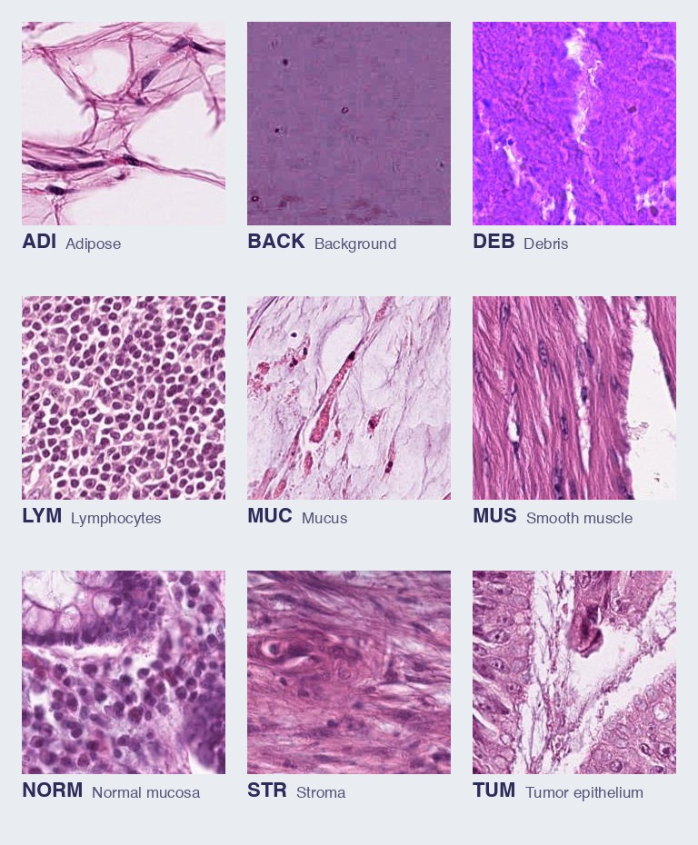
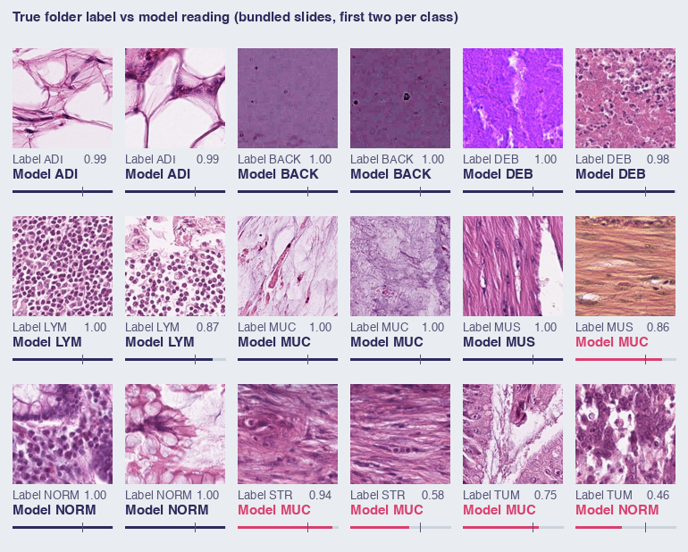

# PathCite: AI Pathology Assistant

PathCite looks at one small patch of colorectal tissue, stained with H&E, and says which of 9 tissue types it most resembles. It also gives a score for how strongly the model favours that answer.

> **Research use only. Not a medical device and not a diagnosis.** The score is the model's raw softmax output, not the chance of being right. The model has no "not tissue" class, so any image gets one of 9 labels.

## What the model sees

The 9 classes come from the NCT-CRC-HE-100K colorectal histology set. Each patch is 224×224 px at 0.5 µm/px.



## What it does

Each row below shows a bundled slide, the folder it came from (the true label), the model's reading and the score. The tick on each ruler marks the 0.70 "uncertain" threshold. Pink means the model disagreed with the folder label.



These are the first two slides of each class, unfiltered, so the misses are real. Across all 72 bundled slides the model gets 59 right (82%). STR is the weakest class (2 of 8). Don't read that as a benchmark.

## What has been built so far

### Model (`model/`)
- A timm `resnet18`, fine-tuned on NCT-CRC colorectal H&E patches. Weights are in `resnet18_finetuned.pt`; the training notebook is `CancerCheckResnetFinetune.ipynb`.
- Class order: 0 ADI, 1 BACK, 2 DEB, 3 LYM, 4 MUC, 5 MUS, 6 NORM, 7 STR, 8 TUM. The mapping was verified against the dataset.
- Notebook external test: accuracy 0.954, macro-F1 0.936, STR recall 0.639.
- Preprocessing is `Resize((224,224))`, ToTensor, ImageNet mean/std.

### Backend (`backend/`)
FastAPI service with `GET /health` and `POST /predict`. It was planned in [`docs/PRD.md`](docs/PRD.md) and built through 8 GitHub issues (#1 to #8, all closed).
- Accepts one PNG, JPEG or TIFF up to 10 MB; the format is detected from the content, not the file name.
- Handles EXIF rotation, 16-bit images, alpha channels, first TIFF frame, and a pixel cap against decompression bombs.
- Returns the label, tissue code, score, an `uncertain` flag (score below 0.7), all 9 probabilities, size warnings and the model version.
- Errors are always `{detail, code}` JSON (413, 415, 422, 500, 503).
- Privacy: images are decoded in memory only, never written to disk or logged.
- 70 offline tests, plus an opt-in smoke test on a Hugging Face dataset (`pytest -m hf -s`).

Details and the full API are in [`backend/README.md`](backend/README.md).

### Frontend (`frontend/`)
Vue 3, TypeScript, Tailwind v4 and shadcn-vue, styled as a microscope bench.
- A folder tree of 72 sample slides (9 class folders of 8) on the left. Pick one by click, Enter or drag.
- A circular "stage" where the slide lands, with a 25 µm scale bar for bundled slides and a toggle for the full square patch.
- The reading shows the tissue name, the score on a ruler, all 9 class probabilities, and whether the model matches the slide's label.
- You can also drop your own image. While a slide is on the stage you have to clear it first.
- 28 unit tests; type-check and build are clean.

Details are in [`frontend/README.md`](frontend/README.md).

## Run it

Backend:

```
cd backend
python3 -m venv .venv && source .venv/bin/activate
pip install -r requirements.txt
uvicorn app.main:app --reload
```

Frontend (in a second terminal):

```
cd frontend
npm install
npm run dev
```

Open http://localhost:5173. The dev server proxies `/api/*` to the backend on port 8000.

Tests: `pytest` in `backend/`, `npm test` in `frontend/`.

## Known limits

- **Domain shift.** On the NCT-CRC set the model scores about 82% through the API. On a different colorectal set (`dpdl-benchmark/colorectal_histology`, 350 images) it scores 8% and predicts MUC for most of them. Other stains, scanners and organs are out of distribution.
- **Uncalibrated score.** Confidence is overconfident under shift, and the `uncertain` flag catches only some wrong answers. A calibration set was held out in training but never used.
- **No out-of-distribution check.** Any image gets a tissue label.
- **STR is the weakest class.**

## Not built yet

Azure storage for slides, auth, batch upload, dark mode, confidence calibration and out-of-distribution detection.

## Credits

Sample slides are from the NCT-CRC-HE-100K / CRC-VAL-HE-7K colorectal histology set: Kather et al., CC-BY-4.0. The figures above are rendered from those slides.
